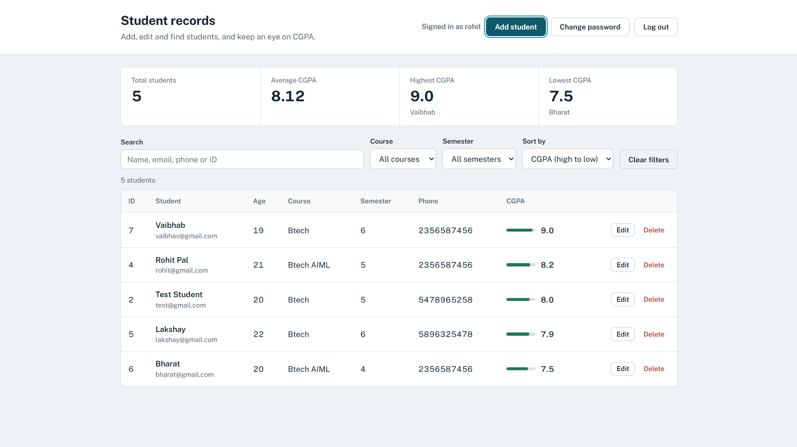
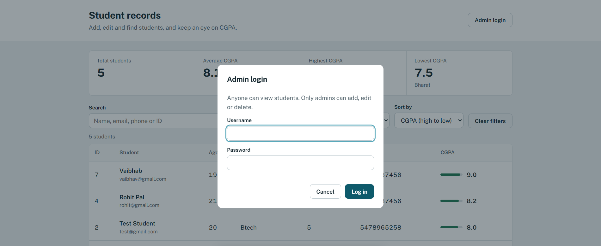

# Student Management System

A full-stack student record manager built with **Java, Spring Boot and MySQL**. Anyone can view students. Only a logged-in **admin** can add, edit or delete them.

## Live Demo

https://rohitpal125.github.io/Student-Management-System-Java/

- **Frontend:** https://rohitpal125.github.io/Student-Management-System-Java/
- **Backend API:** https://student-management-api-e13m.onrender.com/api/students

The backend runs on a free server, so the first load after a break can take up to a minute.

## Screenshots




## Features

### Web app
- View all students in a table (responsive, works on mobile)
- Search by name, email, phone or ID
- Filter by course and semester
- Sort by ID, name, CGPA, age or semester
- Summary numbers (total, average, highest and lowest CGPA) that follow the active filters
- Admin login (visitors can only view)
- Admin can add, edit and delete students
- Admin can change their own password
- Input validation on the page and on the server

### Console app (original version)
- Full CRUD from the terminal
- Search by ID, name or course
- Students per course and per semester
- Sorting and filtering
- Statistics (total, average, highest and lowest CGPA)

## Tech Stack

- **Java 21** and **Spring Boot 4** (REST API)
- **JDBC** with **MySQL**
- **HTML, CSS and JavaScript** (no framework) for the frontend
- **Maven** for build and dependencies
- **Docker** for containerizing the backend
- **Git and GitHub**, **IntelliJ IDEA**

## Architecture

```text
Browser (HTML, CSS, JavaScript)
            |  fetch() with JSON
            v
REST API  (StudentController, AuthController)
            |  AuthInterceptor checks the admin token
            v
Services  (StudentService, AuthService)
            v
DAOs      (StudentDAO, AdminDAO)
            v
DBConnection  ->  MySQL
```

## Project Structure

```text
StudentManagementSystem/
├── pom.xml
├── Dockerfile
├── docs/
│   ├── index.html
│   ├── style.css
│   └── script.js
└── src/
    ├── database/      DBConnection, StudentDAO, AdminDAO
    ├── exception/     StudentNotFoundException
    ├── model/         Student
    ├── service/       StudentService, AuthService
    ├── util/          StudentValidator, PasswordUtil, TokenUtil
    └── main/
        ├── StudentManagementApplication.java   (starts the web app)
        ├── Main.java                           (console version)
        ├── controller/   StudentController, AuthController
        └── config/       WebConfig, AuthInterceptor, AdminBootstrap
```

## REST API

| Method | Endpoint | Who can use it |
|---|---|---|
| GET | `/api/students` | Everyone |
| POST | `/api/students` | Admin only |
| PUT | `/api/students/{id}` | Admin only |
| DELETE | `/api/students/{id}` | Admin only |
| POST | `/api/login` | Everyone (returns a token) |
| POST | `/api/change-password` | Admin only |

Admin requests send the token in the header: `Authorization: Bearer <token>`.

## Security

- Passwords are never stored in plain text. They are hashed with **PBKDF2 (HMAC-SHA256)** and a random salt.
- Login returns a signed token (**HMAC-SHA256**) that expires after 8 hours.
- Write endpoints return `401 Unauthorized` without a valid token. The server enforces this, not just the frontend.
- There is **no public sign-up**. The admin account is created from environment variables.
- No secrets are stored in the source code. Database details and passwords come from environment variables.
- CORS only allows the listed frontend origins.

## Database

MySQL with two main tables. The `admins` table is created automatically when the app starts.

```sql
CREATE TABLE courses (
  course_id INT AUTO_INCREMENT PRIMARY KEY,
  course_name VARCHAR(100) NOT NULL UNIQUE
);

CREATE TABLE students (
  id INT AUTO_INCREMENT PRIMARY KEY,
  name VARCHAR(100) NOT NULL,
  age INT NOT NULL,
  email VARCHAR(150) NOT NULL,
  course_id INT NOT NULL,
  semester INT NOT NULL,
  phone VARCHAR(15) NOT NULL,
  cgpa DOUBLE NOT NULL,
  FOREIGN KEY (course_id) REFERENCES courses(course_id)
);

INSERT INTO courses (course_name)
VALUES ('Btech'), ('Btech AIML'), ('Nursing'), ('GNM'), ('BTC');
```

A student's course must already exist in the `courses` table.

## Environment Variables

| Variable | Purpose | Default |
|---|---|---|
| `DB_URL` | JDBC URL of the database | `jdbc:mysql://localhost:3306/student_management_system` |
| `DB_USER` | Database user | `root` |
| `DB_PASSWORD` | Database password | none |
| `ADMIN_USERNAME` | Admin username (created on first start) | none |
| `ADMIN_PASSWORD` | Admin password, at least 8 characters | none |
| `TOKEN_SECRET` | Secret used to sign login tokens, at least 32 characters | random on every start |
| `RESET_ADMIN_PASSWORD` | Set to `true` for one start to reset a forgotten admin password | off |
| `ALLOWED_ORIGINS` | Comma-separated list of allowed frontend URLs | localhost and the GitHub Pages site |
| `PORT` | Port the server listens on | `10000` in Docker |

Never commit real values for these variables.

## How to Run Locally

### 1. Clone the repository

```bash
git clone https://github.com/Rohitpal125/Student-Management-System-Java.git
```

### 2. Set up MySQL

Create the database and run the SQL from the Database section above.

```sql
CREATE DATABASE student_management_system;
USE student_management_system;
```

### 3. Set environment variables

In IntelliJ IDEA: **Run > Edit Configurations > Environment variables**.

```text
DB_PASSWORD=your_mysql_password;ADMIN_USERNAME=admin;ADMIN_PASSWORD=choose_a_strong_password;TOKEN_SECRET=at_least_32_random_characters_here
```

### 4. Run the backend

Run `main.StudentManagementApplication` from IntelliJ. The API starts on `http://localhost:8080`.

Or build and run the jar:

```bash
mvn clean package
java -jar target/StudentManagementSystem-1.0-SNAPSHOT.jar
```

### 5. Open the frontend

Open `docs/index.html` from IntelliJ (right-click > Open in > Browser). Opening it from IntelliJ matters because the backend allows that origin by default.

### 6. Console version (optional)

Run the `Main` class inside the `main` package.

## Deployment

The project is designed to run on free tiers:

- **Frontend:** GitHub Pages
- **Backend:** Render (Docker, using the `Dockerfile` in this repo)
- **Database:** Aiven for MySQL

Free services sleep when idle, so the first request after a break can be slow.

## Author

Rohit Pal